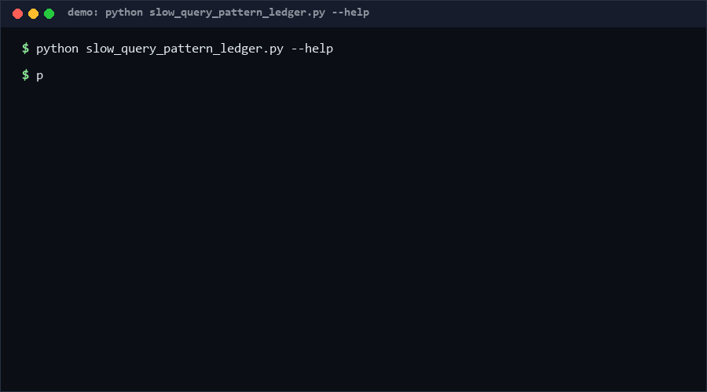

# slow-query-pattern-ledger

A stdlib-only ledger for slow-query logs: normalizes SQL into fingerprints (literals -> `?`), aggregates frequency x duration matrices (count, avg, p50, p95, max), and flags regressions against a baseline. If your slow-query log is a 2 GB file nobody reads, use this; otherwise skip it.

<p align="center"></p>

## Problem

Slow-query logs repeat the same ten bad queries ten thousand ways — every bind value produces a distinct line, so `sort | uniq` tells you nothing, and "this query got slower last week" is unverifiable without a stored baseline. Teams need fingerprint-level aggregation plus a mechanical regression check they can run offline in CI.

## How it works

- `fingerprint(sql)`: strips comments, replaces string and numeric literals with `?`, collapses `IN (?, ?, ...)` lists to `in (?)`, normalizes whitespace and case. Same query shape -> same fingerprint, regardless of bind values.
- `Ledger`: accepts records `{sql | fingerprint, duration_ms}` (invalid records are counted, not fatal), and produces per-pattern rows: count, total, avg, min, max, p50, p95 — sorted by total cost.
- `regressions(baseline, factor=1.5, min_count=3)`: against a baseline `{fingerprint: {avg_ms, count}}`, patterns whose avg exceeds baseline x factor (with enough occurrences) are REGRESSION errors; frequent unseen patterns are NEW_PATTERN infos.
- CLI reads JSONL (malformed lines become warnings, not crashes), supports `--baseline`, `--top`, `--factor`, `--min-count`, `--json`.

## Quickstart (~2 min)

```bash
python slow_query_pattern_ledger.py analyze queries.jsonl                       # ~0.5s
python slow_query_pattern_ledger.py analyze queries.jsonl --baseline base.json  # regression check
python slow_query_pattern_ledger.py analyze queries.jsonl --top 10 --json       # costliest 10
```

Then run the self-test suite: `python self_test.py` (~0.6s).

## Why not X

No direct equivalent found as of 2026-10-13: searches for "SQL fingerprint aggregation / slow query regression baseline" surface database-native features and APM products, not standalone offline ledgers. Nearest neighbors:

- **pt-query-digest (Percona Toolkit)** — the closest classic: fingerprints and aggregates MySQL slow logs, but is MySQL-flavored, Perl-based, and has no stored-baseline regression diffing; this repo is engine-agnostic and baseline-driven.
- **pgBadger** — excellent PostgreSQL report generation; report-per-run with no cross-run regression comparison or exit codes.
- **APM products (Datadog, Sentry performance)** — aggregate queries server-side with hosted baselines; not embeddable, not offline, and lock your query ledger to a vendor.
- **Database EXPLAIN workflows** — analyze one statement deeply; no frequency dimension and no historical comparison.

## Performance

Measured on CPython 3.13.12, Windows 10 Pro, 2026-10-13:

- Full self-test suite (68 cases): **~0.6 s** [Measured] — repro: `python self_test.py`
- Analyze 5,000 query records (50 distinct patterns): **~44 ms/op** [Measured] — repro:

```bash
python -m timeit -s "import slow_query_pattern_ledger as m, json; r=[json.loads(l) for l in open('queries.jsonl')]" "m.analyze_records(r)"
```

Aggregation is O(records); regression diffing is O(patterns). Million-record logs process in seconds, memory-permitting.

## Minimal Fallback

No installs needed beyond Python 3.8+. If you cannot run the ledger:

```bash
sed -E "s/'[^']*'/?/g; s/[0-9]+/?/g" slow.log | sort | uniq -c | sort -rn | head
```

gives a crude frequency table. You lose duration matrices, percentiles, malformed-line accounting, and baseline regression checks.

## Design Trade-offs

- **Fingerprint = normalized string over SQL parsing**: no SQL grammar dependency, works on any dialect and on broken SQL; colliding distinct queries are possible but rare in practice.
- **Counted-not-fatal invalid records**: a bad line in a 10M-line log should not kill the run; it is surfaced as a WARN finding instead.
- **Priority order**: aggregation correctness > regression signal > convenience; `min_count=3` guards against single-hit noise.

## Limits & Second-order Effects

- Fingerprints ignore plan-affecting context: two queries with the same shape can hit different indexes per data distribution, so one pattern can hide bimodal latency (p95 partially exposes this).
- Literal-to-`?` normalization means queries differing only in comments share a fingerprint; comment-based routing would be obscured.
- Widely adopted, teams may tune queries just below the regression factor (1.49x slowdowns pass) or exclude noisy patterns from the baseline — keep baseline edits code-reviewed.

## FAQ

**Which databases are supported?** Any that emit SQL text; the ledger never connects to a database.

**How do I build a baseline?** Run the analysis on a known-good period and save the `--json` rows' `fingerprint`/`avg_ms`/`count` into `{fingerprint: {...}}`.

**When NOT to use this tool?** Skip it if your database or APM already stores per-query-hash histories with alerting — a file-based ledger would be a weaker shadow. Also skip for ad-hoc single-query debugging; EXPLAIN is the right tool.

## [Core Assumptions]

1. Query shape, not bind values, is the right aggregation unit for slow-query triage.
2. A stored baseline of average durations from a known-good period is meaningful for comparison.
3. Duration distributions per pattern are stable enough that avg + p95 summarize them usefully.
4. Logs arrive as line-delimited JSON (JSONL); other formats are converted upstream.

---

Confidence: High (≥80%) for fingerprinting, aggregation, and regression semantics — 68 self-test cases including boundary factor and min_count behavior. Medium (60-79%) that string normalization collisions are rare enough in production logs — plausible, not corpus-validated. Data as of 2026-10-13.

---

Part of the [zhengming-toolbox](https://github.com/chenhz01/zhengming-toolbox) — 105 purpose-built AI-engineering tools across neglected niches.

Related tools: [baseline-drift-ledger](https://github.com/chenhz01/baseline-drift-ledger) · [etl-resume-spec](https://github.com/chenhz01/etl-resume-spec) · [queue-idempotent-consume](https://github.com/chenhz01/queue-idempotent-consume)
